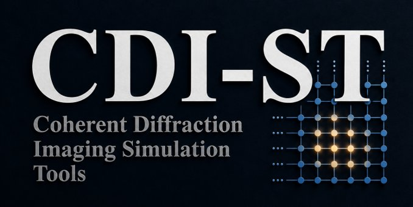
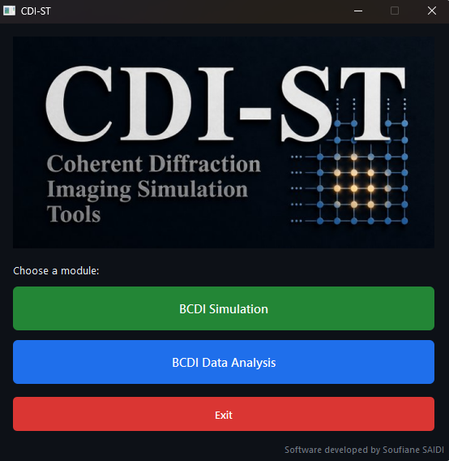
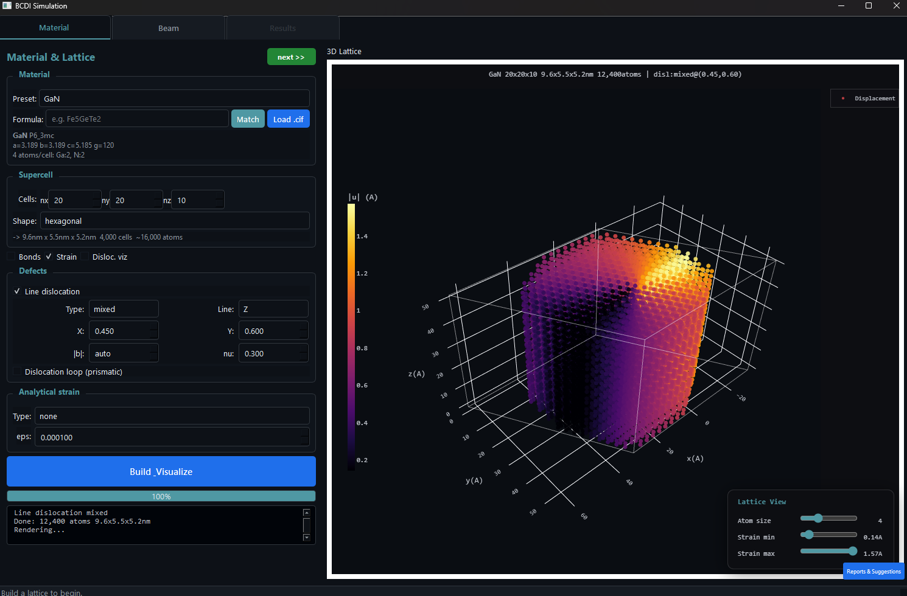
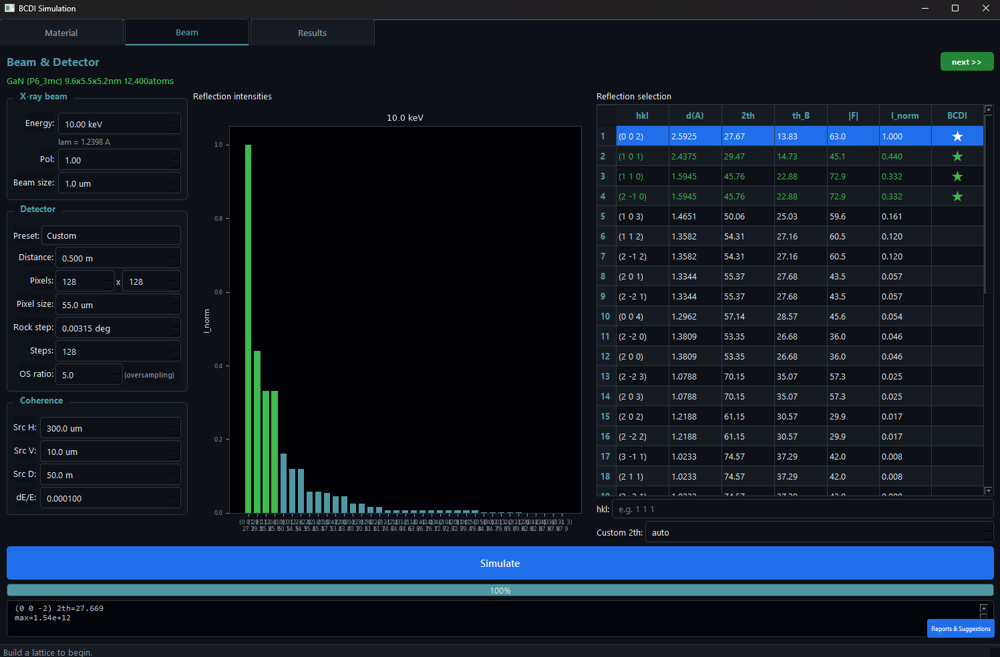
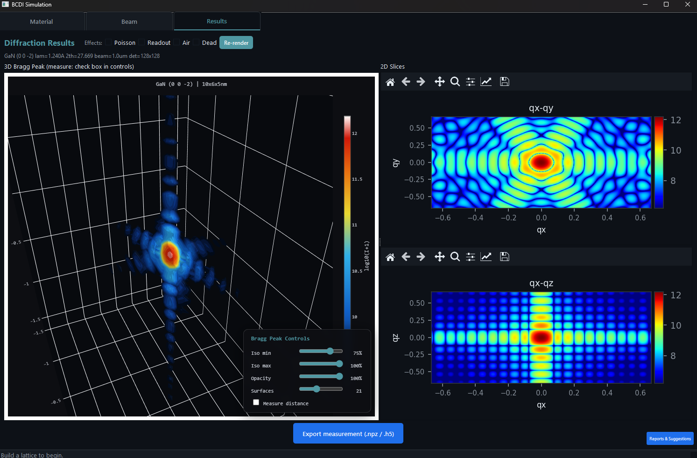
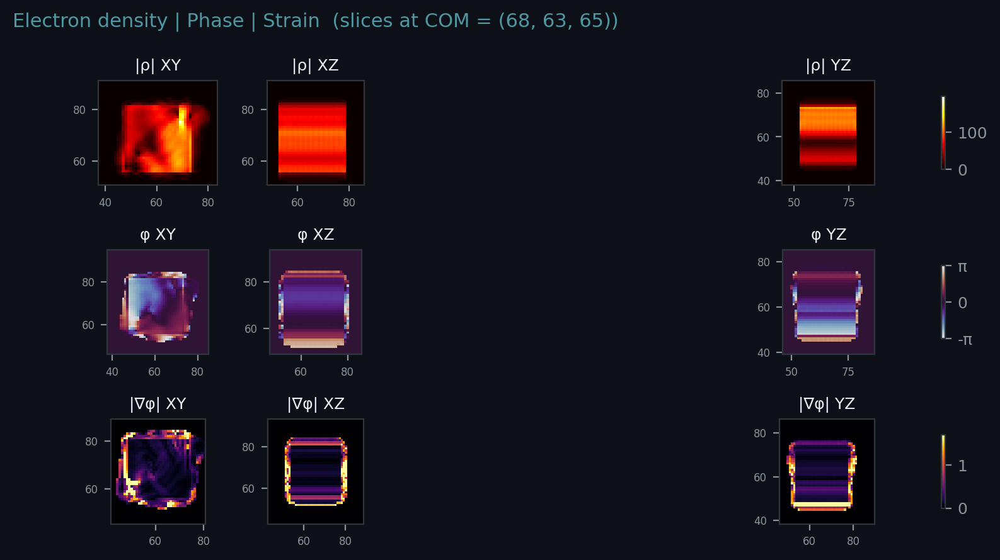
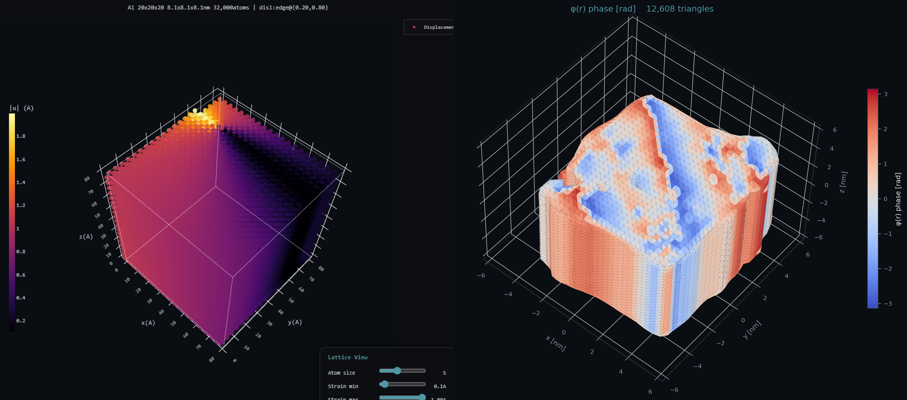

<div align="center">



# CDI-St

**Coherent Diffraction Imaging - Simulation Tools**

An end-to-end Bragg Coherent Diffraction Imaging (BCDI) Python application using low computational resources with an easy to learn GUI:
crystal lattice construction, X-ray scattering simulation, neural-network phase retrieval,
and 3D visualization, in a single GUI.

[](https://pypi.org/project/cdi-stools/)
[](https://pypi.org/project/cdi-stools/)
[](https://opensource.org/licenses/MIT)
[]()

</div>

## Screenshots

<table>
  <tr>
    <td></td>
    <td></td>
	<td></td>
  </tr>
  <tr>
    <td align="center"><sub>Launcher</sub></td>
    <td align="center"><sub>Material - crystal builder</sub></td>
	<td align="center"><sub>Results - simulated Bragg peak</sub></td>
  </tr>
  <tr>
	<td></td>
    <td></td>
    <td></td>
  </tr>
  <tr>
	<td align="center"><sub>3D Viewer - diffraction simulation</sub></td>
    <td align="center"><sub>2D reconstruction</sub></td>
    <td align="center"><sub>3D Viewer - reconstruction</sub></td>
  </tr>
</table>


---

## Installation

```bash
pip install cdi-stools
```

After installation, launch the GUI from any terminal:

```bash
cdi-st or cdi-stools
```

**Support for other beamlines files is coming in future updates...**


> **Note**: `cdi-st` ships a Qt-based GUI. On Linux, you may need system Qt
> dependencies (`sudo apt install libxcb-cursor0 libxkbcommon-x11-0` on Ubuntu/Debian).
> On Windows and macOS the wheel includes everything.

---

## What is BCDI?

Bragg Coherent Diffraction Imaging is a synchrotron technique that reconstructs the
3D shape and atomic-displacement field of nanocrystals by inverting the diffraction
intensity around a Bragg peak. The intensity gives only |F(q)|², so reconstruction
must recover the missing phase by iterative algorithms (HIO, RAAR, ER),
more recently by neural networks.

**CDI-St integrates the entire workflow into one tool:**

| Step | What you do | Where in the GUI |
|---|---|---|
| 1. Build a crystal | Define material, shape, orientation, optional defects | **BCDI Simulation → Material** |
| 2. Set the X-ray geometry | Beam energy, detector geometry, oversampling | **BCDI Simulation → Beam** |
| 3. Simulate diffraction | Compute the 3D Bragg peak | **BCDI Simulation → Results** |
| 4. Generate training data | Build a labeled dataset of (object, diffraction) pairs | **BCDI Data Analysis → Generate Data** |
| 5. Train an unsupervised NN | AutoPhase_NN: physics-driven, no ground truth | **BCDI Data Analysis → AutoPhase_NN** |
| 6. Train a supervised NN | CDI_NN: learning the phase mapping | **BCDI Data Analysis → CDI_NN** |
| 7. Reconstruct | HIO/RAAR/ER on their own, or a network seed refined by them | **BCDI Data Analysis → Reconstruction** |
| 8. Visualize and export | Interactive 3D viewer, ParaView VTI export | **BCDI Data Analysis → 3D Viewer** |

---

## The simulation pipeline

### 1. Material : build the crystal

Choose from the preset materials (Al, Cu, Au, Pt, W, Fe, Si, Ge, SiC (3C and 4H),
ZnO, GaN, Te, Fe3GeTe2, Fe5GeTe2) or import any CIF file. The crystal is built atom-by-atom from the unit cell, replicated to the
requested supercell size.

You can:
- Select the **particle shape**: cube, sphere, cylinder, hexagonal prism, octahedron, dodecahedron
- Set the **target oversampling ratio** (controls how much of the diffraction
  volume the object occupies)
- Add **strain fields**: radial gradient, edge dislocation, random
- Add **dislocations**: edge / screw / mixed, at a configurable position with
  an arbitrary Burgers vector

The 3D lattice view (powered by Plotly) shows every atom in the supercell.

### 2. Beam : define the X-ray geometry

Select a reflection (h k l) from the auto-computed list of allowed peaks. The
search bounds each index separately from the geometry, so materials with a long
c axis keep their high-l reflections: `(0 0 6)` for Fe3GeTe2, `(0 0 8)` for
4H-SiC, `(0 0 6)` and `(0 -1 10)` for corundum. Typing any member of a family
finds that family, whichever member the table happens to list.
The Beam tab also lets you set:
- **Beam energy** (and the resulting wavelength)
- **Detector geometry**: pixel pitch, sample-to-detector distance, detector size
- **Beam size** in microns
- **Detector preset**: Maxipix (516×516), Eiger 2M...etc, custom rectangular

Detector preset auto-fills the geometry parameters.

### 3. Results : run the simulation

CDI-St computes the diffraction in **two paths**:

- **Analytical path** (cube/rectangular shapes, no strain): closed-form Fourier transform of the support
- **FFT path** (any shape, any strain field): full 3D FFT of the complex object

Output: 3D diffraction volume `|F(q)|²`, displayed as 2D slices (qx-qy, qx-qz)
and in an interactive 3D Plotly viewer with iso-surface controls.

You can export the simulation as a `.npz` file ready for the data-analysis side,
or for use as ground truth when training NNs.

---

## The data-analysis pipeline

### 4. Generate Data : create training samples

Generates a dataset of synthetic BCDI samples for NN training. Each sample
contains the ground-truth phase, support, and the simulated diffraction
intensity. You control:

- **Number of samples** (typically 2,000–10,000)
- **Grid size** (64³ recommended for training, 128³ for production inference)
- **Materials** (random or fixed)
- **Particle size variation** (random supercell multiplier)
- **Random dislocations** adds occasional edge/screw/mixed dislocations
- **Random strain** adds occasional radial/edge/random strain fields

Samples save as `sample_XXXXX.npz` and a `manifest.json`. Generation is
parallelizable and resumable.

### 5. AutoPhase_NN : unsupervised physics-driven NN

AutoPhase_NN is a 3D dual-decoder convolutional network that learns to invert the
Fourier modulus constraint **without ground truth**. It predicts the object's
amplitude and phase such that `|FFT(amp · exp(iφ))|` matches the measured
magnitude. The loss is a normalized-magnitude error plus optional regularizers
on phase smoothness and support compactness. This is the network from (Yao, Yudong, 
et al. npj Computational Materials 8.1 (2022) ) reimplemented for this codebase.

Training is GPU-accelerated (CUDA preferred) and converges in a few dozen
epochs on 2,000+ samples. The best checkpoint is saved automatically.

### 6. CDI_NN : supervised 3D U-Net

A 3D U-Net that predicts the phase field from the diffraction magnitude, trained
against the ground-truth phase from the data generator.

Use AutoPhase_NN when you don't trust your simulator's ground truth (or have
none). Use CDI_NN when you have a high-fidelity simulator and want a direct
mapping. Use both via **Both networks averaged** in the Reconstruction tab.

### 7. Reconstruction : invert experimental or simulated data

Load any `.npz` (simulated) or `.h5` (experimental) BCDI file, or convert a
SPEC + EDF scan from ID01 directly via the dialog. Choose:

- **AutoPhase_NN → HIO/RAAR/ER refinement**: network seed, then the classical
  algorithms polish it. The default and best choice.
  - **AutoPhase_NN alone**: one forward pass (~100 ms), with twin-image
  suppression and centring. The result is the network's object, its largest
  connected region above 10 % of its maximum. A quick look.
 - **HIO/RAAR/ER only (no neural network)**: the standard iterative algorithms
  from a random start. No checkpoint, no PyTorch, nothing trained - this is the
  option to use if you cannot run a network, and it is what most published BCDI
  work uses.
- **Both networks averaged (AutoPhase_NN + CDI_NN)**, optionally refined:
  averaging two independent guesses cancels some of the error each makes alone.
  Needs the second checkpoint. (still in need of further work)

If refinement comes out worse than the network alone, the network output is kept.

The output is a complex object (amplitude + phase), a binary support, the
R-factor convergence curve, and 2D slices at the COM of the reconstruction.
Every mode reports the same R-factor, R = sum| k|F| - sqrt(I) | / sum sqrt(I), with
k chosen so the model and the data hold the same total intensity. R alone cannot
say whether a value is good, because its floor depends on the counting statistics,
so it is shown with two references from the same data: the **noise level** (the R
the result would reach if it were exactly right) and the R of a **featureless
sphere** (no phase retrieval at all). The result is then labelled *fits the data to
the noise level*, *partial fit*, *not reconstructed*, or *data too noisy to judge*
when the counts are too low for any reconstruction to be told apart from a
featureless object. R measures how well a result explains the measured
intensities, not whether it is the unique right object.

For experimental data, the loader handles:
- Invalid-pixel flags: EIGER and other counting detectors write the largest
  integer (4294967295 for 32-bit data) into gap, dead and saturated pixels; these
  are zeroed as each frame is read, so they cannot be mistaken for the Bragg peak
- Detector chip-gap masking (Maxipix, Eiger)
- Hot-pixel removal
- Beamstop / direct-beam streak removal
- Bragg-peak-centered cropping
- Optional q-space orthogonalization via xrayutilities (with `[id01]` extra)

### 8. 3D Viewer : interactive visualization

The viewer renders the reconstruction in three modes:

- **Point cloud**: every voxel above threshold, colored by amplitude / phase / strain,
  with per-voxel opacity weighted by intensity
- **Isosurface**: the object as a smooth solid, coloured by the chosen field. Cut
  it with the clip plane and the cut face is filled with the field inside, so a
  dislocation or a strained region shows where the cut passes.
- **Surface only**: the outer skin alone, coloured by the field just beneath it;
  hollow when cut

On both surfaces each point shows the outermost voxels of the object, as ParaView
colours a thresholded volume (on the surface itself the density equals the
threshold everywhere). The colour range comes from the voxels inside the surface
and is the same for all three styles.

Strain is computed from neighbour phase differences, so a 2π phase jump (for
example the branch cut around a dislocation) is not shown as false strain.

**Render quality** changes only how finely the object is drawn, never the data:
values, colour scale, iso level and smoothing are identical at every level. Draft
builds the surface from every second voxel, Standard at the reconstruction's own
resolution, High and Maximum on a 2× and 3× finer trilinear grid (capped at
256³). The point cloud always draws the reconstruction's own voxels.

Controls:
- Threshold (% of peak amplitude), voxel size, opacity, colormap (Turbo by default)
- Color scale auto / manual (`vmin` / `vmax`)
- Clip plane on any axis
- **Live preview**: when on, the render follows every change of threshold,
  voxel size, opacity, colormap, clip plane or field. A quick draft is drawn while
  you drag and full quality follows when you stop; rotation and zoom are kept.
- Mouse: left-drag rotate, right-drag pan, wheel zoom, double-click reset
- Export PNG snapshot or VTI (ParaView)

---

## Citing

If you use CDI-St in published research, please cite:

```bibtex
@software{saidi_cdi_st_2026,
  author       = {Saidi, Soufiane},
  title        = {CDI-St: Coherent Diffraction Imaging - Simulation Tools},
  year         = {2026},
  publisher    = {GitHub},
  url          = {https://github.com/Refze/CDI-St}
}
```

---

## License

MIT, see [LICENSE](LICENSE).

## Author

**Soufiane SAIDI** - saidisoufiane@hotmail.com

We heavily encourage you to use the in-app **Reports & Suggestions** button to send any type of feedback.

---

## Acknowledgments

Built on the shoulders of the BCDI and python community:
[PyNX](https://pynx.esrf.fr/), [BCDI-Utilities](https://github.com/carnisj/bcdi),
[cdiutils](https://github.com/clatlan/cdiutils), [Atomsk](https://atomsk.univ-lille.fr/) , [xrayutilities](https://xrayutilities.sourceforge.io/),
[scikit-image](https://scikit-image.org/), [PyQt6](https://www.riverbankcomputing.com/software/pyqt/),
and the AutoPhaseNN paper by Yao et al.(2022) (https://doi.org/10.1038/s41524-022-00803-w).
